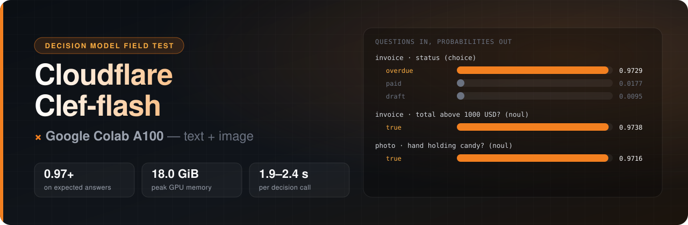
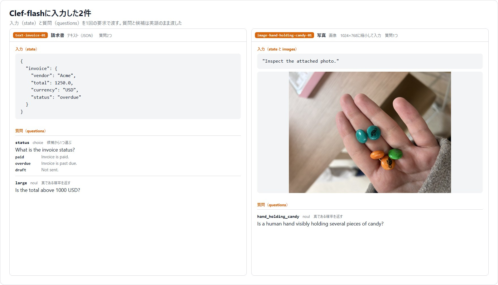
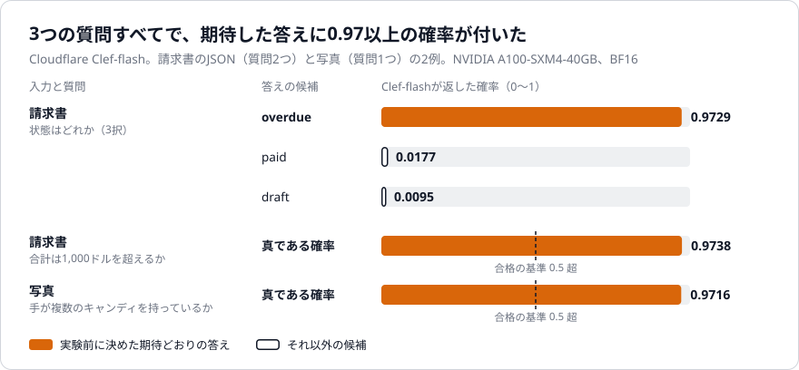
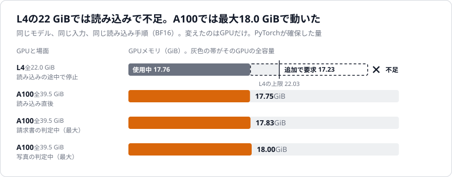
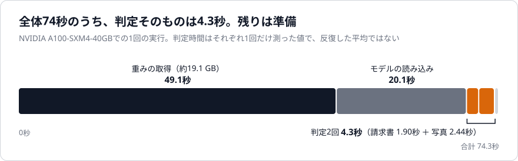
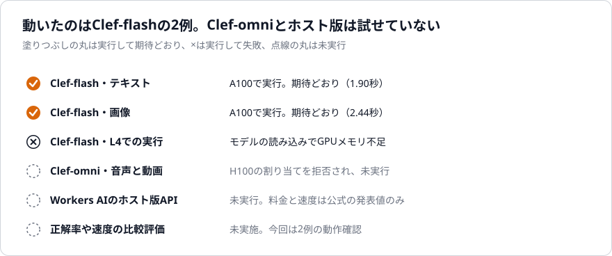
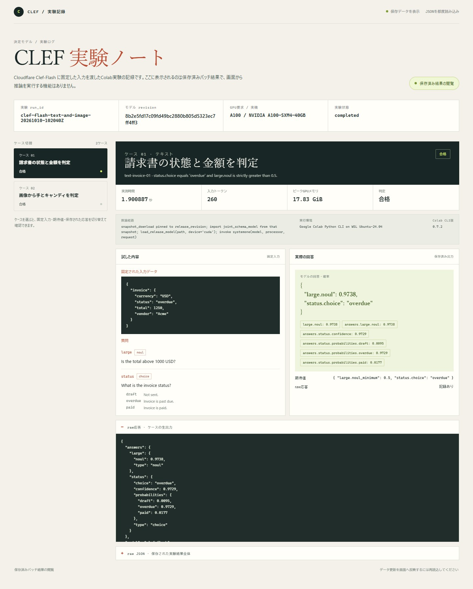
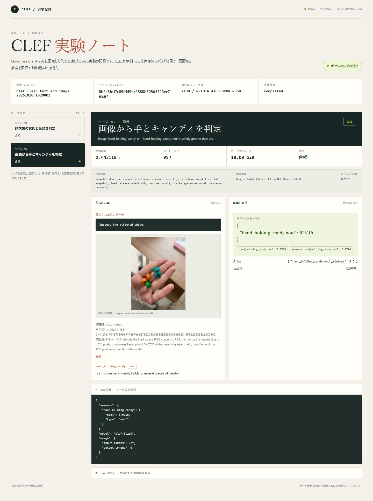

<p align="center">
  
</p>

<h1 align="center">Cloudflare Clef-flash × Google Colab A100</h1>

<p align="center">
  <b>文章を書かず、選択肢に確率を付けるAIを、公開重みから動かしてみた。</b><br>
  Cloudflareの判断モデル Clef-flash に請求書のJSONと写真を渡した実測の記録と、再現用コード一式。
</p>

<p align="center">
  
  
  
  <br>
  
  
  
  
</p>

<p align="center">
  <a href="ARTICLE.md"><b>解説記事</b></a> ·
  <a href="#結果">結果</a> ·
  <a href="#自分のデータで試す">クイックスタート</a> ·
  <a href="#フォルダ構成">フォルダ構成</a> ·
  <a href="docs/RUN_REPORT.md">実行報告</a>
</p>

---

[Clef-flash](https://huggingface.co/Cloudflare/clef-flash) は、入力と質問と答えの候補を渡すと、候補ごとの確率を返すCloudflareの判断モデルです。このリポジトリでは、公開重みをGoogle ColabのA100で動かし、請求書のJSONと写真の2例に合計3つの質問を出しました。入力、期待する答え、合格の基準は、モデルを動かす前に固定しています。

<p align="center">
  
</p>

## 結果

3問とも、期待した答えに0.97以上の確率が付きました（2026-10-10、A100 40GB、BF16）。判定1回は1.90秒と2.44秒、GPUメモリは最大18.0 GiBです。

<p align="center">
  
</p>

<p align="center">
  
</p>

<p align="center">
  
</p>

<details>
<summary>グラフの元になった数値</summary>

| 例と質問 | 返ってきた答え | 確率 | 入力トークン | 判定時間 |
| --- | --- | ---: | ---: | ---: |
| 請求書：状態（3択） | overdue | 0.9729 | 260 | 1.901秒 |
| 請求書：合計は1,000ドル超か | 真 | 0.9738 | （同じ要求） | （同じ要求） |
| 写真：手が複数のキャンディを持つか | 真 | 0.9716 | 927 | 2.443秒 |

| GPUと場面 | 全容量 | PyTorchの使用量 |
| --- | ---: | ---: |
| L4：読み込みの途中 | 22.03 GiB | 17.76 GiB使用中に追加で17.23 GiBを要求して停止 |
| A100：読み込み直後 | 39.49 GiB | 17.75 GiB |
| A100：請求書の判定中 | 39.49 GiB | 最大17.83 GiB |
| A100：写真の判定中 | 39.49 GiB | 最大18.00 GiB |

| 段階 | 時間 |
| --- | ---: |
| 重みの取得（約19.1 GB） | 49.1秒 |
| モデルの読み込み | 20.1秒 |
| 判定2回 | 4.3秒 |
| 合計 | 74.3秒 |

</details>

- L4（22 GiB）では、公式の手順のままだとモデルの読み込みでGPUメモリが足りませんでした。
- 音声と動画も扱う Clef-omni は、必要なGPU（約64GB）を確保できず、動かしていません。
- Cloudflareのホスト版（Workers AI）は使っていません。料金と速度は公式の発表値で、今回は確かめていません。

<p align="center">
  
</p>

2例・3問の動作確認です。請求書の入力には状態がそのまま書かれており、正解率や速度の評価にはなりません。判定時間はそれぞれ1回だけ測った値です。詳しい条件は [docs/RUN_REPORT.md](docs/RUN_REPORT.md) にあります。

<details>
<summary>結果を確認した画面</summary>

<p align="center">
  
</p>

<p align="center">
  
</p>

</details>

## 自分のデータで試す

GPUメモリが24GBを超えるColabランタイムが要ります（実験ではA100）。Hugging Faceのログインは不要です。

```bash
git clone https://github.com/Sunwood-ai-labs/clef-flash-colab-field-test.git
cd clef-flash-colab-field-test

colab new -s clef --gpu A100
colab install -s clef transformers==5.10.2
colab restart-kernel -s clef

# quickstart/clef_flash_demo.py の REQUESTS を書き換えると、自分の入力と質問で試せる
colab exec -s clef --timeout 1800 -f quickstart/clef_flash_demo.py

colab stop -s clef
colab usage                # 割り当てが残っていないことを確かめる
```

Colab CLIを使わない場合は、A100のノートブックで `transformers==5.10.2` を入れてランタイムを再起動し、`quickstart/clef_flash_demo.py` の中身をセルに貼って実行します。

応答と期待値の照合は、GPUなしで試せます。

```bash
python quickstart/check.py results/raw-responses/text-invoice-01.json quickstart/expected/text-invoice-01.json
```

| ファイル | 内容 | 確認状況 |
| --- | --- | --- |
| [`quickstart/clef_flash_demo.py`](quickstart/clef_flash_demo.py) | 重みの取得、読み込み、判定。revisionと公式コードのSHA-256は実験と同じ値に固定 | 実験スクリプトの抜粋。構文の確認のみで、この形では未実行 |
| [`quickstart/check.py`](quickstart/check.py) | 応答と期待値の照合 | `results/raw-responses/` の2件で、記事と同じ数字と判定になることを確認 |
| [`quickstart/expected/`](quickstart/expected) | 2例の期待値 | 上の確認で使用 |
| [`experiment/run_clef.py`](experiment/run_clef.py) | 実験で実際に動かしたスクリプト | 実験で使用（A100で成功、L4で失敗） |
| [`experiment/bootstrap_clef.py`](experiment/bootstrap_clef.py) | 入力と期待値をColabの中に作るスクリプト | 実験で使用。埋め込んだ設定はパスを置き換えて作り直しており、その形では未実行 |
| `colab` コマンド | セッションの作成、導入、実行、停止 | 実験で使ったコマンド。上の並びを通しでは未実行 |

重みのダウンロード元（[revision 8b2e5fd1](https://huggingface.co/Cloudflare/clef-flash/tree/8b2e5fd17c09fd49bc2880b805d5323ec7ff4ff3)）と写真のURLは、応答を確認しています。

## フォルダ構成

| フォルダ | 内容 |
| --- | --- |
| `quickstart/` | 自分のデータで試すスクリプトと、採点スクリプト |
| `experiment/` | 実験で実際に動かしたスクリプトと、事前に固定した入力・期待値（`contract.json`） |
| `results/` | A100での結果、L4での失敗の記録、モデルの生の応答、H100の割り当てを拒否されたログ |
| `assets/` | ヘッダー画像、グラフ、入力のタイル画像、それらを作るスクリプト |
| `docs/` | 実行の詳細な報告と、公式資料の調査メモ |

グラフとヘッダーは `python assets/make_charts.py` と `python assets/make_header.py` で、`results/` の数値から作り直せます。

次のものは含めていません。

- モデルの重みと公式コード（`joint_schema_model.py`）。実行時にHugging Faceから取得します。
- 写真の元ファイル。[Hugging Faceのドキュメント用画像](https://huggingface.co/datasets/huggingface/documentation-images/resolve/main/p-blog/candy.JPG)で、実行時にURLから取得します。`assets/` の画像には縮小したものが写っています。
- 実行ログの全文と、結果の閲覧画面のコード。

結果と設定のJSONに含まれていたローカルのパスは置き換えました。そのため `experiment/contract.json` のSHA-256は、結果に記録された `contract_sha256` と一致しません。数値は変えていません。

## 使用したモデルとランタイム

| 役割 | モデル・ランタイム |
| --- | --- |
| 判断モデル | [Cloudflare/clef-flash](https://huggingface.co/Cloudflare/clef-flash) revision `8b2e5fd1`。Qwen3.5-9Bに判断用のヘッドを足したもの。BF16 |
| 推論の経路 | 配布物の `joint_schema_model.py` にある `load_release_model` と `systemone` |
| GPU | Google Colab の NVIDIA A100-SXM4-40GB |
| ソフトウェア | Python 3.13.15、PyTorch 2.11.0+cu130、Transformers 5.10.2、Pillow 11.3.0 |
| 操作 | Colab CLI 0.7.2 |

モデルの利用条件は、配布元の記載に従ってください。公式の発表は [Cloudflareの記事](https://blog.cloudflare.com/clef-faster-cheaper-multimodal/)、調べた内容は [docs/sources.md](docs/sources.md) にあります。
